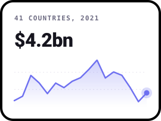
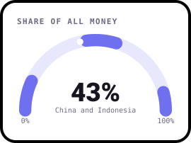
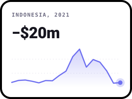
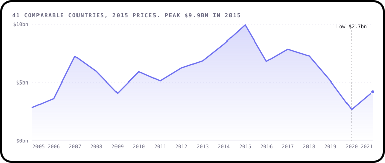
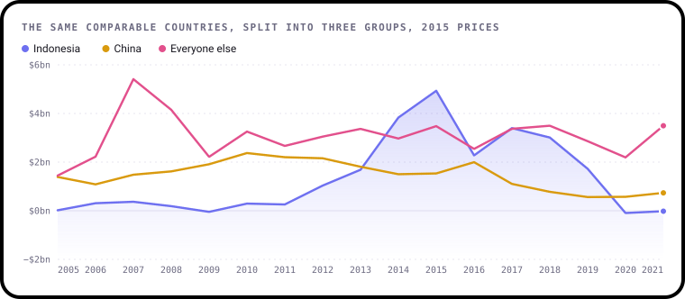
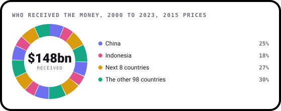
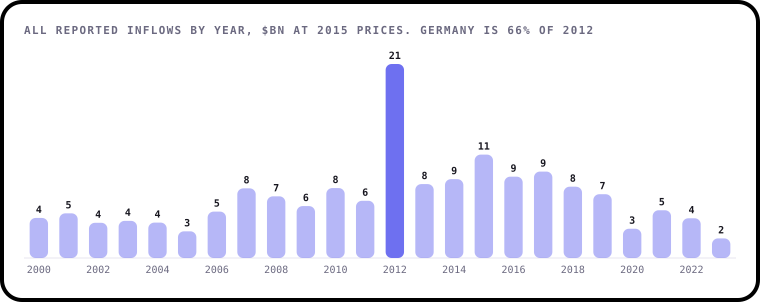

# Who Invests in the World's Farms?

**An analysis of foreign direct investment in agriculture, forestry and fishing, using World Bank open data for 108 countries from 2000 to 2023.**

[](https://github.com/ShazMoghaddam/FAO-FDI-Analysis-World-Bank-Open-Data/actions/workflows/checks.yml)
[](https://pypi.org/project/bezel-charts/)
[](LICENSE)

Headlines about money pouring into or fleeing from global agriculture usually rest on a few big totals. This project
looks underneath them: who actually received the money, what drove the swings, and which numbers can't be trusted at face
value.

<p align="center">
  
  
  
</p>

> **Every chart here is drawn with [bezel-charts](https://pypi.org/project/bezel-charts/), an open-source Python library
> created by Shaz Moghaddam, the author of this project.** It turns pandas data into clean, self-contained SVG charts.

---

## Key findings

<!-- key-findings:start -->
### Investment surged, then fell back

Across the 41 countries that reported every year, yearly inflows grew from a low of **$2.9bn** in 2005 to
**$9.9bn** in 2015, then dropped 73% to $2.7bn in 2020.



### One country explains most of the fall

Indonesia alone accounts for **69%** of the fall from 2015 to 2020. Everyone outside
Indonesia and China was back at $3.5bn by 2021, level with $3.5bn in 2015.



### Two countries took 43% of the money

China and Indonesia received **43%** of all money across 108 countries. The bottom 54
countries shared **2.7%**.



### One number looks like a global boom

A single figure, Germany in 2012, is **$13.8bn**, or 66% of everything reported that year.
Germany's other 20 years add up to $194m.


<!-- key-findings:end -->

**[Read all seven findings, and what the data can't tell you →](findings/README.md)**

| # | Finding | |
|---|---|---|
| 1 | Investment surged, then fell back | The trend across countries that reported every year |
| 2 | One country explains most of the fall | Indonesia, China and everyone else |
| 3 | One number looks like a global boom | Why Germany in 2012 is handled separately |
| 4 | Two countries took most of the money | How concentrated it all is |
| 5 | Asia dominates, Africa barely registers | The picture by continent, and its gaps |
| 6 | Money leaves as well as arrives | How often more money flows out than in |
| 7 | Past values alone don't forecast this | A fair test of two simple forecasts |

---

## Run it yourself

You'll need Python 3.10 or newer.

```sh
git clone https://github.com/ShazMoghaddam/FAO-FDI-Analysis-World-Bank-Open-Data.git
cd FAO-FDI-Analysis-World-Bank-Open-Data
python3 -m venv .venv && source .venv/bin/activate
pip install -r requirements-dev.txt

python data/prepare.py      # raw download to tidy table
python findings/build.py    # charts and report
pytest                      # checks the data and the numbers
```

Or open [`notebooks/fdi_analysis.ipynb`](notebooks/fdi_analysis.ipynb) for the same analysis with the working shown.

## What's in the repo

```
├── data/
│   ├── raw/FAO_FDI.csv       The World Bank download, untouched
│   ├── prepare.py            Raw file to tidy table
│   ├── fdi_inflows.csv       One row per country and year
│   ├── countries.csv         Each country's continent
│   └── sources.json          Where everything came from
├── findings/
│   ├── analysis.py           Every calculation, as small functions
│   ├── charts.py             Every chart
│   ├── build.py              Writes the charts and the report
│   └── README.md             The full report
├── notebooks/fdi_analysis.ipynb
├── charts/                   The SVG charts
├── tests/                    Checks on the data and the findings
└── .github/                  Automatic checks and dependency updates
```

## Data

The figures are the **FDI inflows to Agriculture, Forestry and Fishing** indicator (`FAO_FDI_23080`), compiled by the Food
and Agriculture Organization of the United Nations and published through
[World Bank Data360](https://data360.worldbank.org). The snapshot in this repo was added in January 2026.
[`data/sources.json`](data/sources.json) has the details.

Code and content in this repo are [MIT licensed](LICENSE). The data remains subject to its publishers' terms.

---

Created by **Shaz Moghaddam** · London
[Website](https://shazmoghaddam.github.io) · [LinkedIn](https://www.linkedin.com/in/shazmoghaddam)
