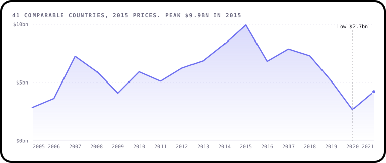
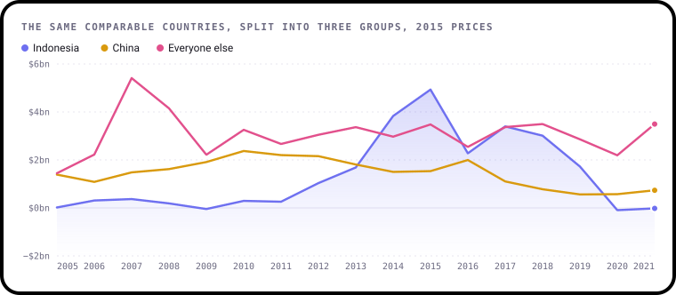
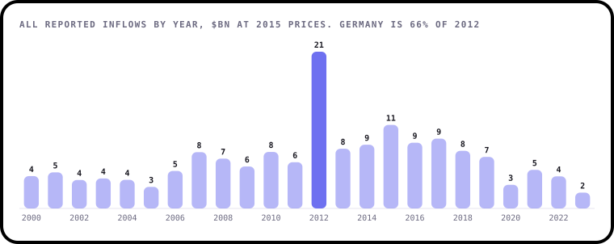
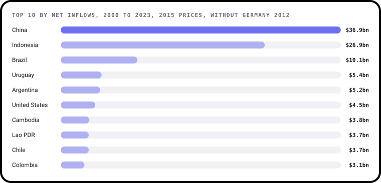
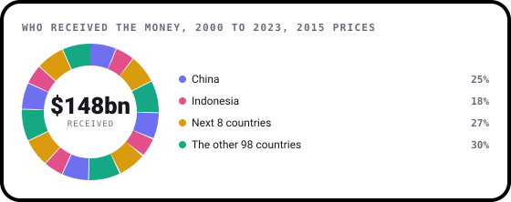
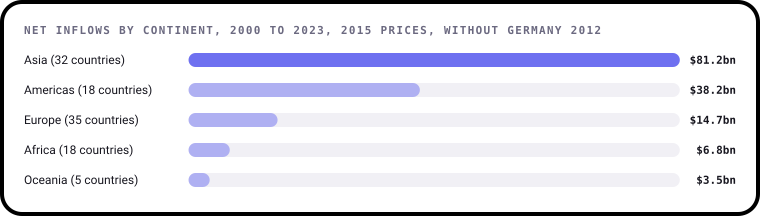
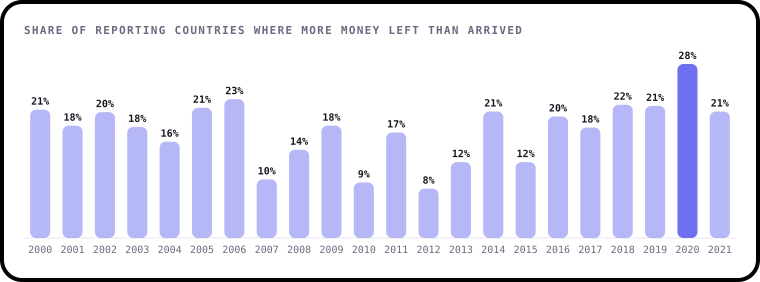
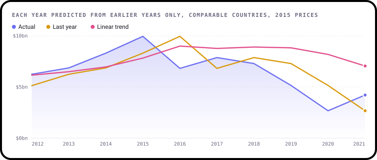

# Findings

Where foreign money goes when it invests in farming, forestry and fishing, across 108 countries from 2000 to
2023. This page is written by [`build.py`](build.py), so every number comes straight from the data.

All figures are in US dollars at constant 2015 prices, so inflation doesn't flatter later years. A negative number
means more money left a country than arrived.

## 1. Investment surged, then fell back

Yearly inflows grew from a low of $2.9bn in 2005 to $9.9bn in 2015, about 3.5 times as much. By
2020 they had dropped 73% to $2.7bn, then recovered to $4.2bn in 2021.

This chart follows only the 41 countries with a figure for every year from 2005 to 2021, because the number of
countries reporting changes each year. Those 41 countries hold between 72% and 99% of all
money reported in any of those years, leaving out the German figure in finding 3.

## 2. One country explains most of the fall

Indonesia went from $4.9bn in 2015 to -$93m in 2020. That single change is 69% of the whole
fall, and with China it reaches 82%. China itself slid gradually, from $2.4bn in 2010 to $0.6bn in 2019.

Everyone else tells a calmer story: $3.5bn in 2015, $2.2bn in 2020, and $3.5bn in 2021. A headline
about a global retreat from agricultural investment would be wrong. This is mostly two countries.

## 3. One number looks like a global boom

Add up every country and 2012 towers over everything else. That spike is one figure: Germany at $13.8bn, which is
66% of the year. Germany's other 20 years come to $194m combined.

The data doesn't say what happened, so the figure stays in the raw file and this chart, and is left out of the
rankings and shares in findings 4 and 5. Germany isn't in the comparable group either, because it has gaps.

## 4. Two countries took 43% of the money

China received $36.9bn and Indonesia $26.9bn. The top 3, with Brazil at $10.1bn, took 50%, and the top 10
took 70%. The bottom 54 of 108 countries shared 2.7%.

Shares here count only money received. A country that lost money overall counts as zero rather than a negative share.

## 5. Asia dominates, and Africa barely registers

Asia accounts for 56% of net inflows and the Americas 26%. Africa accounts for 5%, though only
18 African countries appear in this data, so treat that as a partial picture.

## 6. Money leaves as well as arrives

72 of 108 countries recorded a net outflow in at least one year. On average 18% of reporting countries saw
one in any year, ranging from 8% in 2012 to 28% in 2020, the first year of the pandemic.

## 7. Past values alone don't forecast this

Predicting each year from 2012 to 2021 using only the years before it, a straight trend line missed by $2.1bn on
average. Simply repeating last year's figure missed by $1.6bn. The trend line kept predicting high figures long after
the money had turned, and neither method saw 2020 coming.

With ten test years this is a small sample, so read it as a warning rather than a verdict. Forecasting these flows
would need outside information such as commodity prices and policy changes, which this dataset doesn't include.

## What this data can't tell you

- **It isn't truly global.** 108 countries appear, and many report only some years. Coverage falls from 73 countries in
  2021 to 61 in 2022 and 30 in 2023, so the apparent drop in those final years is largely missing data. The
  trend stops at 2021 for that reason.
- **It shows what, not why.** Nothing here explains Indonesia's fall or Germany's spike, and the timing of the 2020 low
  doesn't prove the pandemic caused it.
- **It counts recorded flows.** These are figures countries report, and methods vary between them.

## How it was worked out

1. [`data/prepare.py`](../data/prepare.py) reshapes the raw World Bank file into one row per country and year.
2. [`analysis.py`](analysis.py) holds every calculation as a small, tested function.
3. [`charts.py`](charts.py) draws each chart with [bezel-charts](https://pypi.org/project/bezel-charts/).
4. [`notebooks/fdi_analysis.ipynb`](../notebooks/fdi_analysis.ipynb) walks through the same steps with the working shown.

## A correction to the first version

The first version of this project added up the raw value column without noticing the file holds most country-years
twice, once in current dollars and once at 2015 prices. That made the 2000 to 2023 total $306bn instead of
$158bn, and 2015 alone $22.3bn instead of $11.2bn. Its France model trained on those mixed rows, using a random
split that let it learn from the future, and scored an R² of -0.14. Everything here replaces that work.
